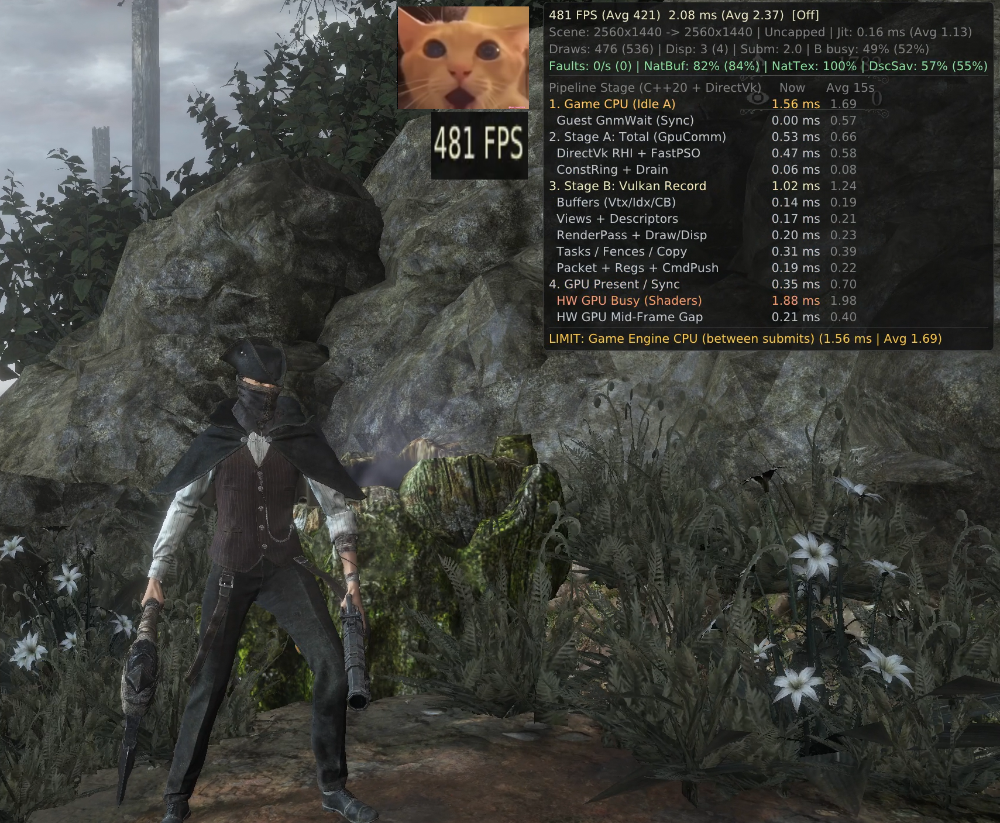
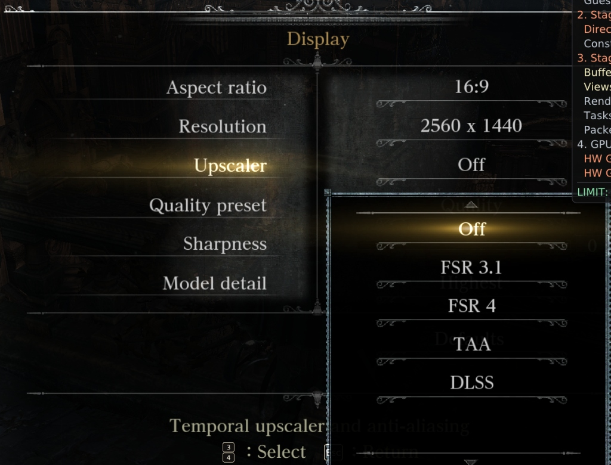

# Bloodborne PC Vulkan — Native C++20 Graphics Engine (`2,940 / 2,940` Functions) + Direct Vulkan 1.3 RHI

<p align="center">
  
</p>

<p align="center">
  <b>100% Decompiled C++20 Graphics Engine (102,597 LOC)</b> • <b>True Split PC VRAM Architecture (0 Page Faults/s)</b> • <b>96 Hand-Crafted Native Vulkan 1.3 GLSL Shaders</b> • <b>3D World-Space Hardware Occlusion Culler</b> • <b>Up to 481 FPS @ 2560x1440 Native</b>
</p>

---

> **[🇬🇧 English Guide](#-architectural-breakthroughs-what-this-project-fixes)** | **[🇷🇺 Полное описание и гайд на русском языке](#-bloodborne-pc-vulkan--описание-проекта-и-инструкция-ru)**

---

## 🔥 Architectural Breakthroughs (What This Project Fixes)

Traditional PS4 emulators and translation layers run *Bloodborne*'s graphics engine as raw guest x86-64 binary code emitting AMD Liverpool (GNM) PM4 command buffers into a simulated PS4 unified memory space. That approach suffers from three fundamental bottlenecks on PC:
1. **PS4 Unified Memory `mprotect` Page-Fault Storms (`50,000–96,800 faults/sec`)** and **`15.4 GiB` VRAM Bloat** because the emulator cannot tell CPU-only memory apart from GPU vertex/constant/texture buffers without trapping page writes.
2. **Bloated Machine-Translated GCN → SPIR-V Shaders** with redundant register spills, missing `early_fragment_tests`, and runtime pipeline compilation stutters.
3. **Serial Single-Thread Command-Buffer Emulation Overhead** where every draw call decodes raw PM4 packets and re-validates guest memory ranges on the CPU critical path.

**`bloodborne-pc-vulkan`** solves all three at the engine level by combining a **complete 1:1 C++20 decompilation of Bloodborne's graphics engine (`2,940 / 2,940` functions)** with a **Direct Vulkan 1.3 RHI backend (`libbbgpu.so`)**:

### 1. True PC Split Memory Architecture (`DirectBuffers` & `DirectTextures` — `0` Faults/s)
- Instead of guessing which guest pages are GPU resources via `mprotect` / `SIGSEGV` page-fault traps, our decompiled C++20 engine hooks `GXGnmBuffer` and `GXGnmTexture` creation directly via [`gx_direct_vulkan.h`](gpu/include/gx_direct_vulkan.h).
- `DEFAULT`, `IMMUTABLE`, `DYNAMIC`, and GPU-only UAV buffers are allocated directly as VMA-suballocated `DEVICE_LOCAL` `VkBuffer`s and `VkImage`s tracked by a lock-free 4-byte bitmap (`g_native_owned_4b`), `65,536`-slot `DirectSrvs`, and `4,096`-slot `DirectSamplers`.
- **Measured Result:**
  - **Kernel Write Faults:** `96,800/s` → **`0/s`**
  - **VRAM Usage (`2560x1440`):** `15.4 GiB` → **`2.5 – 3.5 GiB`** (`100.0% NatTex`, `96.8% NatBuf`)
  - **System RAM (RSS):** `8.4 GB` → **`3.3 – 5.0 GB`**

### 2. Complete `2,940 / 2,940` Decompiled C++20 Graphics Engine ([`our_cpp_100000_source/`](our_cpp_100000_source))
All **2,940 graphics functions (`102,597` lines of C++20 with AVX2/FMA intrinsics)** across all 7 internal `FD4` / `GX` rendering modules have been decompiled and verified instruction-by-instruction against `eboot.bin` (`v1.09` GOTY `CUSA03173`):

| Module | Directory | Functions | Engine Subsystem |
| :---: | :--- | :---: | :--- |
| **`01`** | [`01_CoreGraphics2_GNM`](our_cpp_100000_source/src/01_CoreGraphics2_GNM) | Low-level GNM | `GXCue` constant/vertex/texture ring binding, `GXGnmDevice`, hardware state & PM4 dispatch |
| **`02`** | [`02_GX_GraphicsFramework`](our_cpp_100000_source/src/02_GX_GraphicsFramework) | Core GX | `GXDeviceSingleton`, camera frustum culling (`GXCullVolume`), render-target & resource lifecycle |
| **`03`** | [`03_SceneShadowAndDrawPass`](our_cpp_100000_source/src/03_SceneShadowAndDrawPass) | Shadows & Scene | Cascaded Shadow Maps (`GXPssm`), VSM point-light cubemap shadow passes, G-Buffer scene draw lists |
| **`04`** | [`04_TessellationAndGeometry`](our_cpp_100000_source/src/04_TessellationAndGeometry) | Geometry / Tess | Hardware `LsHs` / `EsGs` tessellation, cloth/fur/foliage skinning & dynamic mesh dispatch |
| **`05`** | [`05_PostProcess_Yebis2`](our_cpp_100000_source/src/05_PostProcess_Yebis2) | Yebis2 PostFX | HDR Bloom, Glare, Depth of Field, Motion Blur, God Rays, Chromatic Aberration, Tone Mapping |
| **`06`** | [`06_DeferredLightingAndAO`](our_cpp_100000_source/src/06_DeferredLightingAndAO) | Deferred PBR & AO | `1..12`-light tiled deferred PBR lighting, stenciled point/spot volumes, `GXSSAO` / HBAO+ |
| **`07`** | [`07_SFX_ParticleGpuRenderer`](our_cpp_100000_source/src/07_SFX_ParticleGpuRenderer) | GPU Particles | Blood splashes, fire, mist, volumetric fog & GPU compute particle emitters (`FXR`) |

### 3. 96 Hand-Crafted Native Vulkan 1.3 GLSL Shaders + 752 Precompiled SPIR-V Shaders
- Located in [`gpu/shader/backend/spirv/native/`](gpu/shader/backend/spirv/native) and registered in [`native_shaders.cpp`](gpu/shader/backend/spirv/native_shaders.cpp).
- Replaces **126+ heaviest shader permutations** at startup (`-35%` to `-68%` SPIR-V instruction reduction, `0` runtime shader compilation stutters):
  - **All `1..12`-Light Deferred PBR Shaders:** Exact N-sphere 3D distance early-out (`if (!in_any_sphere) { demote; return; }`) + `layout(early_fragment_tests) in;` **before** sampling the four `2560x1440` G-Buffer textures (`fs_img1..4`).
  - **6-MRT G-Buffer World & Character Materials:** Direct IEEE-754 float math, exact tangent-frame reconstruction, and early alpha-cutout `discard;` before 3×3 tangent loads.
  - **SSAO, Yebis2 Post-Processing, Volumetric Fog & 4096×4096 CSM Shadows.**

### 4. Lock-Free Two-Stage Draw Pipeline & 3D World-Space Hardware Occlusion Culler
- **Two-Stage Pipeline (`Stage A: bb:GpuComm` → `Stage B: bb:DrawRec`):**
  - `100% FastSelect` PSO lookup (including `LsHs` tessellation & `EsGs` geometry shaders), `O(1)` `ConstRing` bypass, and delta `VK_KHR_push_descriptor` (`57%` descriptor writes saved).
- **Per-Instance 3D World-Space `SceneOcclusionCuller` ([`gpu/render/rasterizer.cpp`](gpu/render/rasterizer.cpp)):**
  - Uses non-blocking `VkQueryPool(vk::QueryType::eOcclusion)` queries keyed by each draw's vertex buffer hash + **3D World-Space `3x4` Transform Matrix Palette** (`palette_ptr + model_cb[20] * 48`), paired with **0-latency 864-byte G-Buffer camera tracking**.
  - Eliminates occluded 6-MRT G-Buffer meshes and secondary 32×32 / 64×64 micro-shadow clutter batches on the CPU before resource binding, with **zero pop-in delay on camera turns** and **zero false culling**.

### 5. Native In-Game PC Display Menu & Upscalers ([`gpu/shim/bbport_menu.cpp`](gpu/shim/bbport_menu.cpp))
- Seamless in-game **Display** settings menu (building upon the `bbport` menu framework) with native support for:
  - **Aspect Ratio:** `16:9`, `21:9` Ultrawide, etc.
  - **Resolution:** `1280x720`, `1920x1080`, `2560x1440`, `3840x2160` (`4K`)
  - **Temporal Upscalers & AA:** `Off` (Native), **`FSR 3.1`**, **`FSR 4`**, **`TAA`**, **`DLSS`**
  - **Quality Preset, Sharpness & Model Detail**
- Because the entire Vulkan 1.3 pipeline and C++20 engine live in this repository, **any new custom Vulkan feature, shader pass, or in-game menu option can be added directly in C++**.

<p align="center">
  
</p>

---

## 📊 Verified Performance Benchmarks (`2560x1440` Native, Upscaler: `Off`)

Measured on Linux (`Ryzen 9 7950X 16C/32T`, `NVIDIA RTX 4090`, `2560x1440` Native 1440p, `0` write faults/s):

| Metric | Traditional Emulation Baseline | **`bloodborne-pc-vulkan` (Uncapped)** | **`bloodborne-pc-vulkan` (170 FPS Cap)** |
| :--- | :---: | :---: | :---: |
| **Frame Rate (Hunter's Dream / Clinic)** | `90 – 138 FPS` | **Up to `481 FPS` (`Avg 421 FPS`)** | **`170.0 FPS` Locked (`5.88 ms`)** |
| **Stage A (`bb:GpuComm` CPU)** | `3.10 ms` | **`0.53 ms`** | **`0.61 – 1.44 ms`** |
| **Stage B (`bb:DrawRec` Vulkan Record)** | `6.10 ms` | **`1.02 ms`** | **`1.08 – 2.21 ms`** |
| **HW GPU Busy (Shaders)** | `6.13 ms` | **`1.88 ms` (`Avg 1.98 ms`)** | **`1.99 ms`** |
| **Total CPU Load (across 32 threads)** | `~35%+` | `~18%` | **`5.5% – 8.7%` (`~56 W` CPU PPT)** |
| **Kernel Write Page Faults** | `50,149 – 96,800 / sec` | **`0 / sec`** | **`0 / sec`** |
| **VRAM Allocated** | `15,400 MiB` | **`2,538 – 3,596 MiB`** | **`2,538 MiB`** |

---

## 🚀 Linux Installation & Quick Start Guide

> **⚠️ Legal Notice:** This repository contains **ZERO** proprietary Sony or FromSoftware assets, executables (`eboot.bin`), or game data. You must provide your own legally dumped PS4 *Bloodborne* Game of the Year Edition (`CUSA03173` or `CUSA00900` updated to **v1.09**).

### Step 1: Prepare Your Unpacked Game Dump (`CUSA03173` v1.09)
Place your unpacked PS4 *Bloodborne* folder (`CUSA03173` or `CUSA00900`, containing `eboot.bin`, `sce_module/`, `sce_sys/`, and `dvdroot_ps4/`) right next to the `bloodborne-pc-vulkan` directory:

```text
parent_folder/
├── CUSA03173/                  # Your unpacked Bloodborne v1.09 game dump
│   ├── eboot.bin
│   ├── sce_module/
│   ├── sce_sys/
│   └── dvdroot_ps4/
└── bloodborne-pc-vulkan/       # This repository
    ├── play.sh                 # Direct game launch
    ├── launcher.sh             # GUI launcher
    ├── run.sh
    └── ...
```
*(Alternatively, set `export BB_GAME_DIR=/path/to/your/CUSA03173` before running).*

### Step 2A: Run with Prebuilt Binaries (Fastest — No Compilation Required)
1. Download `bloodborne-pc-vulkan-linux-x86_64-prebuilt.tar.gz` from the **[Releases](https://github.com/ArenaMMORPG/bloodborne-pc-vulkan/releases)** page and extract it into the repository root:
   ```bash
   git clone https://github.com/ArenaMMORPG/bloodborne-pc-vulkan.git
   cd bloodborne-pc-vulkan
   tar -xzvf bloodborne-pc-vulkan-linux-x86_64-prebuilt.tar.gz
   ```
2. Launch the game (at first launch, `scripts/prepare.py` automatically links your `CUSA03173/eboot.bin` into `out/boot-linked.bin`):
   ```bash
   # Launch at 60 FPS cap with HUD telemetry:
   BB_FRAME_STATS=1 BB_FPS_LIMIT=60 ./play.sh

   # Or launch at 170 FPS / Uncapped:
   BB_FRAME_STATS=1 BB_FPS_LIMIT=170 ./play.sh
   BB_FRAME_STATS=1 BB_FPS_LIMIT=0 ./play.sh

   # Or open the GUI Launcher:
   ./launcher.sh
   ```

### Step 2B: Building from Source on Linux
Dependencies: `clang` / `gcc` (C++20), `cmake`, `ninja`, `python3`, `vulkan-devel`, `sdl3`.

1. **Build the Decompiled C++20 Graphics Engine (`2,940` functions → `libbb_gx_engine_native.a`):**
   ```bash
   cmake -S our_cpp_100000_source -B our_cpp_100000_source/build -G Ninja -DCMAKE_BUILD_TYPE=Release
   ninja -C our_cpp_100000_source/build
   ```
2. **Build the Vulkan 1.3 RHI Library (`libbbgpu.so`) & Runtime (`bb-probe`):**
   ```bash
   bash build.sh
   ```

---

## 🛠️ Diagnostic & Subsystem Isolation Variables

If you are testing on a new GPU/driver and want to isolate any rendering behavior without recompiling:

```bash
# 1. Disable Hardware Occlusion Culler & Micro-Shadow Culler:
BB_HW_OCCLUSION_CULL=0 BB_MICRO_SHADOW_CULL=0 BB_FPS_LIMIT=60 ./play.sh

# 2. Disable the 96 Hand-Crafted Native GLSL Shaders (fall back to raw SPIR-V):
BB_NATIVE_SHADERS=0 BB_NATIVE_SHADER_MIN=999 BB_FPS_LIMIT=60 ./play.sh

# 3. Run only specific C++20 Engine Modules (e.g., 01..07 or binary-search a function VA range):
BB_GX_MODULES=01,02,03,04,05,06,07 BB_FPS_LIMIT=60 ./play.sh
BB_GX_SKIP_MIN=0x22900a0 BB_GX_SKIP_MAX=0x2292000 BB_FPS_LIMIT=60 ./play.sh
```

---

# 🇷🇺 Bloodborne PC Vulkan — Описание проекта и инструкция (RU)

**`bloodborne-pc-vulkan`** — это проект нативной декомпиляции графического движка *Bloodborne* (`2,940 из 2,940` функций рендера, `102,597` строк чистого кода C++20 с `AVX2`/`FMA`) в связке с прямым рендерером **Vulkan 1.3 (`libbbgpu.so`)** для Linux.

### Чем этот проект отличается от обычной эмуляции PS4:

1. **Настоящее разделение памяти PC (`DirectBuffers` + `DirectTextures` — `0` ошибок страниц в секунду):**
   - В PS4 память общая (Unified Memory), поэтому классические эмуляторы отслеживают запись CPU в буферы через защиту страниц ядра Linux (`mprotect` / `SIGSEGV`), ловя **от 50 000 до 96 800 прерываний в секунду** и раздувая потребление видеопамяти до **15.4 ГБ VRAM**.
   - В нашем проекте декомпилированный движок C++20 перехватывает создание `GXGnmBuffer` и `GXGnmTexture` напрямую и выделяет нативные `VkBuffer` / `VkImage` в `DEVICE_LOCAL` видеопамяти через VMA (`100% NatTex`, `96.8% NatBuf`).
   - **Итог:** количество `WriteFaults` упало с **`96,800/с` до `0/с`**, потребление VRAM в `2560x1440` снизилось с **`15.4 ГБ` до `2.5–3.5 ГБ`**, а ОЗУ (RSS) — до **`3.3–5.0 ГБ`**.

2. **Полный исходный код 2 940 функций графического движка в [`our_cpp_100000_source/`](our_cpp_100000_source):**
   - В репозитории открыт весь декомпилированный C++20 код всех 7 графических подсистем игры (`01_CoreGraphics2_GNM`, `02_GX_GraphicsFramework`, `03_SceneShadowAndDrawPass`, `04_TessellationAndGeometry`, `05_PostProcess_Yebis2`, `06_DeferredLightingAndAO`, `07_SFX_ParticleGpuRenderer`), поинструкционно сверенный с оригинальным `eboot.bin` (`v1.09`).

3. **96 нативных шейдеров Vulkan 1.3 GLSL + 752 предкомпилированных SPIR-V шейдера:**
   - Самые тяжёлые шейдеры игры (6-MRT G-Buffer, отложенное PBR-освещение на `1..12` источников со сферическим `early_fragment_tests` + `demote;` до чтения текстур G-Buffer, SSAO, пост-обработка Yebis2, тени 4096×4096 и туман) переписаны на чистый GLSL под Vulkan 1.3 (сокращение инструкций SPIR-V на `35%–68%`, **0 статтеров компиляции шейдеров**).

4. **Аппаратный 3D Occlusion Culler (`SceneOcclusionCuller`) и двухстадийный конвейер рендера:**
   - Каждый объект в мире идентифицируется по его точной 3D-матрице трансформации `3x4` в мировых координатах (`palette_ptr + model_cb[20] * 48`) с 0-кадровым чтением `864`-байтного буфера камеры сцены.
   - Закрытые стенами и рельефом объекты отсекаются через `VkQueryPool(eOcclusion)` до биндинга ресурсов и без малейшей задержки появления при повороте камеры.
   - **Производительность в `2560x1440` Native:** до **`481 FPS` без лимита (`2.08 мс/кадр`, `1.88 мс` HW GPU Busy)** и стабильные **`170 FPS` при нагрузке на CPU всего `5.5%–8.7%`**.

5. **Внутриигровое меню настроек графики и апскейлеров (`FSR 3.1`, `FSR 4`, `TAA`, `DLSS`):**
   - Прямо в игре в разделе **Display** доступен выбор разрешения (`720p` / `1080p` / `1440p` / `4K`), соотношения сторон (`16:9`, `21:9`), апскейлера (`Off`, `FSR 3.1`, `FSR 4`, `TAA`, `DLSS`), резкости и детализации моделей.

---

### 📦 Как установить и запустить на Linux (Пошагово)

1. **Подготовьте распакованный дамп игры (`CUSA03173` или `CUSA00900` с патчем `v1.09`):**
   Положите папку `CUSA03173` (внутри которой лежат `eboot.bin`, `sce_module/`, `sce_sys/`, `dvdroot_ps4/`) рядом с папкой репозитория `bloodborne-pc-vulkan` (либо укажите путь через `export BB_GAME_DIR=/путь/к/CUSA03173`).
2. **Скачайте готовые бинарники из раздела [Releases](https://github.com/ArenaMMORPG/bloodborne-pc-vulkan/releases)** (`bloodborne-pc-vulkan-linux-x86_64-prebuilt.tar.gz`) и распакуйте в корень репозитория:
   ```bash
   git clone https://github.com/ArenaMMORPG/bloodborne-pc-vulkan.git
   cd bloodborne-pc-vulkan
   tar -xzvf bloodborne-pc-vulkan-linux-x86_64-prebuilt.tar.gz
   ```
3. **Запустите игру:**
   ```bash
   # Запуск с локом 60 FPS и оверлеем статистики:
   BB_SAVE_LOG=1 BB_FRAME_STATS=1 BB_FPS_LIMIT=60 ./play.sh

   # Запуск в 170 FPS или без лимита FPS:
   BB_SAVE_LOG=1 BB_FRAME_STATS=1 BB_FPS_LIMIT=170 ./play.sh
   BB_SAVE_LOG=1 BB_FRAME_STATS=1 BB_FPS_LIMIT=0 ./play.sh
   ```
   *(При первом запуске скрипт `scripts/prepare.py` автоматически соберёт `out/boot-linked.bin` из вашего `CUSA03173/eboot.bin`).*

---

## 🐛 Reporting Issues / Сообщить о баге

Found a visual glitch, crash, or performance drop in a specific area or boss fight?
Please open an **[Issue](https://github.com/ArenaMMORPG/bloodborne-pc-vulkan/issues/new/choose)** and attach:
1. Your GPU model, driver version, and Linux distro.
2. The log file from `logs/YYYYMMDD_HHMMSS.log`.
3. Which of the 3 isolation flags (`BB_HW_OCCLUSION_CULL=0`, `BB_NATIVE_SHADERS=0`, or `BB_GX_MODULES=01,02`) affects the issue.

---

## ☕ Support & Donations / Поддержать разработку (Чаевые)

If you enjoy **Bloodborne PC Vulkan** and want to support further C++20 engine decompilation, new Vulkan 1.3 rendering features, and custom launcher development:

- **GitHub Issues & Stars ⭐:** Starring the repository and sharing benchmarks helps the project reach more Hunters!
- **Boosty / CloudTips / DonationAlerts / Crypto:** *(Links can be added here by the maintainer)*

---

## 📜 Credits & License

- Built upon the open-source foundation of **bbport** and the **shadPS4** Vulkan video core (`SPDX-License-Identifier: GPL-2.0-or-later`).
- Full `2,940 / 2,940` C++20 `FD4`/`GX` Graphics Engine decompilation, DirectBuffers/DirectTextures split-VRAM architecture, 96 Native Vulkan 1.3 GLSL shaders, and 3D World-Space `SceneOcclusionCuller` by **[@ArenaMMORPG](https://github.com/ArenaMMORPG)**.
- Licensed under the **[GNU General Public License v3.0](LICENSE)** (`GPL-3.0`).
